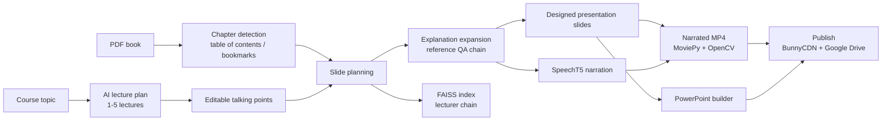
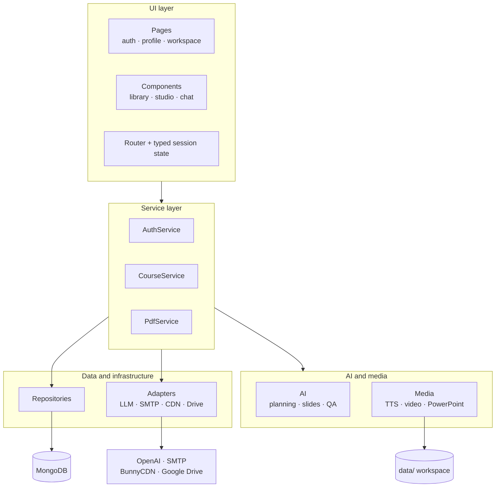

<div align="center">

<h1>CourseGen</h1>

<p><strong>Turn a PDF book or a short course outline into a complete, narrated, publishable course.</strong></p>

<p>
  
  
  
  
  
  
</p>

<p>
  <a href="#overview">Overview</a> &middot;
  <a href="#what-it-does">Features</a> &middot;
  <a href="#how-it-works">Pipeline</a> &middot;
  <a href="#architecture">Architecture</a> &middot;
  <a href="#quick-start">Quick start</a> &middot;
  <a href="#configuration">Configuration</a> &middot;
  <a href="#quality-checks">Quality</a> &middot;
  <a href="#troubleshooting">Troubleshooting</a>
</p>

</div>

---

## Overview

Creating a course from a textbook is slow and repetitive: read the material, outline lectures, write slides, expand the talking points, record narration, assemble a video, export a deck, and publish it. CourseGen automates that entire chain in one Streamlit application.

**Input:** a PDF book with a table of contents, or a course topic plus a lecture count.

**Output:** a structured lesson plan, designed slides, slide-by-slide narration, a narrated MP4 lecture video, an AI lecturer you can question, and a PowerPoint deck that can be published with shareable links.

The project is also an exercise in software engineering: the original flat scripts were rebuilt as a layered Python package with dependency injection, explicit interfaces, typed configuration, a custom exception hierarchy, and a test suite.

> **Project type:** final-year graduation project. Feature-complete for academic submission; configuration and operational limits are documented below.

### At a glance

| Aspect | Detail |
| --- | --- |
| **Codebase** | 45 Python modules, roughly 4,500 lines in `coursegen/` |
| **Architecture** | UI → services → AI / media → repositories and adapters |
| **Generation** | OpenAI GPT-3.5, LangChain, FAISS, instructor-xl embeddings |
| **Media** | SpeechT5 narration, Whisper transcription, MoviePy, OpenCV |
| **Documents** | PyMuPDF for PDFs, python-pptx for decks, Pillow for slide art |
| **Persistence** | MongoDB for accounts and the per-user media library |
| **Publishing** | BunnyCDN for video, Google Drive for presentations |
| **Quality** | 14 unit tests passing, Ruff clean, `compileall` clean |

---

## What it does

### Two ways to build a course

| Entry point | Best for | Flow |
| --- | --- | --- |
| **Upload a book** | Existing textbooks and lecture notes | Upload a PDF → detect chapters from its outline → choose chapters → generate |
| **Type a course** | New courses with no source material | Enter a topic and 1–5 lectures → AI drafts a plan → edit the talking points → generate |

Both paths converge on the same generation service, so the expensive steps are implemented once.

### What one generation produces

| Output | Description |
| --- | --- |
| **Lesson plan** | Lecture titles with per-slide talking points |
| **Presentation slides** | Expanded, redesigned slide content per lecture |
| **Narration** | SpeechT5 audio clips grouped by lecture and slide |
| **Lecture video** | Rendered MP4 with slides, narration, and subtitles |
| **AI lecturer** | A FAISS-backed LangChain chain for course Q&A |
| **PowerPoint deck** | Generated with the selected template, font, sizes, and colours |
| **Hosted links** | Video on BunnyCDN and deck on Google Drive, saved to the account |

### Platform features

**Accounts and access**
- Registration with email verification (Gmail or Outlook SMTP).
- Login by email or account name, with protected pages behind an auth guard.
- Forgot-password flow using a verification code and a reset step.
- Password-gated profile area with profile editing, password change, and verified email change.

**Workspace**
- Per-user media library for generated videos and presentations, with preview and delete.
- Presentation studio: six built-in backgrounds (`Default`, `Dark`, `Fancy`, `History`, `Modern`, `White`), custom background upload, font selection with a live preview, title/content font sizes, and colour pickers.
- Publishing with local PowerPoint download as a fallback when cloud credentials are missing.
- Dark teal theme, progress panels for long operations, and user-safe error dialogs.

---

## How it works



### The generation pipeline

1. **Plan the slides.** Chapter text or typed talking points are converted into slide outlines.
2. **Expand the content.** A pre-built reference conversation chain answers questions about each point and produces richer explanations.
3. **Design the slides.** The expanded explanations are turned into presentation-ready slides.
4. **Prepare the lecturer.** Slide text is chunked, embedded with instructor-xl, indexed in FAISS, and wrapped in a LangChain conversation chain.
5. **Synthesise narration.** SpeechT5 generates audio per slide section.
6. **Render the video.** Short slides and narration are assembled into an MP4 with MoviePy and OpenCV.
7. **Publish on demand.** The deck is built from the chosen style, the video is uploaded to BunnyCDN, the deck is uploaded to Google Drive, and both links are saved to the user's account.

> **The pipeline is stateful by design.** The generated `CourseArtifacts` object carries slides, explanations, audio paths, video path, conversation, and publishing links. The UI stores one result per workflow so users can review and publish without regenerating.

### The `conversation.pkl` reference file

The explanation step loads a pre-built LangChain chain from `data/artifacts/conversation.pkl` (or `CONVERSATION_PICKLE`). This file is **excluded from Git** because of its size.

It must be created with `langchain==0.0.184`. A pickle created with another version will fail to load, and the app will show a clear configuration error instead of crashing.

---

## Architecture

The UI never talks to MongoDB, OpenAI, the filesystem, or third-party APIs directly. Every workflow passes through a service, and every external dependency is behind an adapter.



### Layer responsibilities

| Layer | Package | Responsibility |
| --- | --- | --- |
| **UI** | `coursegen/ui/` | Pages, router, session state, theme, reusable components |
| **Services** | `coursegen/services/` | Use cases: authentication, PDF ingestion, course pipeline |
| **AI** | `coursegen/ai/` | Lecture planning, slide generation, explanation expansion, Q&A |
| **Media** | `coursegen/media/` | TTS, subtitles, video assembly, PowerPoint, fonts |
| **Repositories** | `coursegen/repositories/` | MongoDB client and user persistence |
| **Infrastructure** | `coursegen/infrastructure/` | External adapters: LLM, SMTP, BunnyCDN, Google Drive |
| **Security** | `coursegen/security/` | Validation and PBKDF2 password hashing |
| **Domain** | `coursegen/models.py`, `errors.py` | Anemic dataclasses and the user-facing exception hierarchy |

<details>
<summary><strong>Full project layout</strong></summary>

```text
.
├── app.py                     # Thin Streamlit entry point
├── coursegen/
│   ├── config.py              # Frozen, env-driven Settings
│   ├── errors.py              # CourseGenError hierarchy
│   ├── logging_config.py
│   ├── models.py              # UserAccount, CourseArtifacts, PresentationStyle, ...
│   ├── utils.py               # Shared helpers
│   ├── repositories/
│   │   ├── mongo.py
│   │   └── user_repository.py
│   ├── security/
│   │   ├── passwords.py       # PBKDF2-SHA256 + legacy upgrade
│   │   └── validators.py
│   ├── infrastructure/
│   │   ├── llm.py
│   │   ├── email_sender.py
│   │   ├── cdn_storage.py
│   │   ├── google_drive.py
│   │   └── protocols.py       # FileStorage, PresentationUploader
│   ├── ai/
│   │   ├── lecture_generator.py
│   │   ├── slide_generator.py
│   │   ├── slide_explainer.py
│   │   ├── qa_engine.py
│   │   └── prompts.py
│   ├── media/
│   │   ├── tts.py
│   │   ├── subtitles.py
│   │   ├── video_builder.py
│   │   ├── presentation_builder.py
│   │   └── fonts.py
│   ├── services/
│   │   ├── auth_service.py
│   │   ├── chapters.py
│   │   ├── pdf_service.py
│   │   └── course_service.py  # Unified generation pipeline
│   └── ui/
│       ├── router.py          # Page registry, auth guard, lazy imports
│       ├── state.py           # Typed session-state helpers
│       ├── theme.py
│       ├── components.py
│       ├── dialogs.py
│       └── pages/
│           ├── auth_pages.py
│           ├── profile_pages.py
│           └── course_page.py
├── assets/
│   ├── backgrounds/           # Presentation templates (tracked)
│   └── fonts/                 # Local fonts (not tracked)
├── data/                      # Runtime workspace (ignored)
├── secrets/                   # Credentials (ignored)
├── tests/
├── .env.example
├── requirements.txt
├── requirements-dev.txt
└── pyproject.toml
```

</details>

### Engineering highlights

| Principle | How it is applied |
| --- | --- |
| **Single responsibility** | Each package owns one concern; pages render, services orchestrate, adapters integrate. |
| **Dependency injection** | `CourseService` and `AuthService` accept every collaborator in their constructors and create defaults lazily. |
| **Composition over inheritance** | Behaviour is assembled from small classes rather than deep hierarchies. |
| **Structural interfaces** | `FileStorage` and `PresentationUploader` are `Protocol` contracts, so storage backends can be swapped. |
| **One pipeline** | `generate_from_book` and `generate_from_lectures` both converge on `_finish_generation`; no duplicated workflow. |
| **Typed configuration** | `Settings` is a frozen dataclass loaded from environment variables, with legacy secret-file fallbacks. |
| **Typed UI state** | `coursegen/ui/state.py` centralises every session key and prevents widget/domain collisions. |
| **Explicit errors** | Expected failures derive from `CourseGenError`; the UI maps them to friendly dialogs, unexpected ones go to logs. |
| **Secure defaults** | PBKDF2-SHA256 passwords, escaped chat HTML, sanitised upload names, environment-only secrets. |
| **Performance-aware UI** | Pages are imported lazily, so signing in does not load torch, transformers, or MoviePy. |
| **Testability** | Pure logic lives outside Streamlit and can be unit-tested without a browser or a database. |

### For reviewers: where to look

| What to inspect | File |
| --- | --- |
| Application entry point | `app.py` |
| Auth guard and lazy page registry | `coursegen/ui/router.py` |
| Central generation pipeline | `coursegen/services/course_service.py` |
| Constructor injection in practice | `CourseService.__init__`, `AuthService.__init__` |
| Persistence boundary | `coursegen/repositories/user_repository.py` |
| Adapter contracts | `coursegen/infrastructure/protocols.py` |
| Password hashing and legacy upgrade | `coursegen/security/passwords.py` |
| Error hierarchy | `coursegen/errors.py` |
| Unit tests | `tests/` |

---

## Tech stack

| Area | Technologies |
| --- | --- |
| **Web application** | Streamlit 1.35, streamlit-option-menu |
| **LLM and retrieval** | OpenAI GPT-3.5, LangChain 0.0.184, FAISS, instructor-xl |
| **Speech** | SpeechT5, Transformers, OpenAI Whisper |
| **Media** | MoviePy, OpenCV, pydub, pysrt, Pillow |
| **Documents** | PyMuPDF, python-pptx |
| **Data** | MongoDB, PyMongo |
| **Cloud services** | BunnyCDN, Google Drive API |
| **Email** | SMTP (Gmail, Outlook) |
| **Quality** | unittest, Ruff, `compileall` |

---

## Quick start

### Prerequisites

- **Python 3.10.x** — the pinned dependencies target this version.
- **MongoDB** — a local server or an Atlas cluster.
- **FFmpeg** on `PATH` — required by MoviePy and Whisper.
- **The reference chain** — `conversation.pkl` created with `langchain==0.0.184`.
- **An OpenAI API key** — required for planning, explanations, and slide generation.
- **Optional:** a CUDA-capable GPU. The app falls back to CPU, but narration will be slower.
- **Disk and time:** the first generation downloads the SpeechT5 and instructor-xl models.

### 1. Create a virtual environment

```bash
python -m venv .venv

# Git Bash on Windows
source .venv/Scripts/activate

# PowerShell
# .venv\Scripts\Activate.ps1

# cmd
# .venv\Scripts\activate.bat
```

### 2. Install dependencies

```bash
pip install -r requirements.txt
```

<details>
<summary><strong>Optional: install a CUDA build of PyTorch</strong></summary>

```bash
pip install torch==2.2.1 --index-url https://download.pytorch.org/whl/cu118
pip install -r requirements.txt
```

`TTS_DEVICE` and `WHISPER_DEVICE` default to `cuda`. Set both to `cpu` if you do not have a compatible GPU.

</details>

### 3. Configure the application

```bash
cp .env.example .env
```

Open `.env` and fill in at least the MongoDB connection, the OpenAI key, and the reference-pickle path. Everything else can wait until you use that feature.

### 4. Add the reference chain

Place your `conversation.pkl` at:

```text
data/artifacts/conversation.pkl
```

Or point `CONVERSATION_PICKLE` somewhere else. Generation stops with a clear message if the file is missing or incompatible.

### 5. Add file-based credentials only if needed

```text
secrets/service_account.json
```

This is required only for publishing decks to Google Drive.

### 6. Make sure MongoDB is reachable

Use a local server or Atlas and match `MONGODB_URI`. The app shows a friendly error if the database is unreachable.

### 7. Launch

```bash
streamlit run app.py
```

Open [http://localhost:8501](http://localhost:8501), register an account, verify the email code, and generate your first course.

> **Minimum to generate a course:** MongoDB, `OPENAI_API_KEY`, and `conversation.pkl`. Publishing and email flows stay disabled until their credentials are provided; the UI tells you which variables are missing.

---

## Configuration

All values are read from `.env`. Legacy files `secrets/api_key` and `api_key` are still loaded as fallbacks for existing local installations.

| Variable | Purpose | Default / requirement |
| --- | --- | --- |
| `MONGODB_URI` | MongoDB connection string | `mongodb://localhost:27017` |
| `MONGODB_DB` | Database name | `grad` |
| `OPENAI_API_KEY` | OpenAI credential | required for generation |
| `OPENAI_MODEL` | Chat model | `gpt-3.5-turbo` |
| `OPENAI_TEMPERATURE` | Generation creativity | `0.8` |
| `BUNNY_STORAGE_API_KEY` | BunnyCDN storage key | required for video publishing |
| `BUNNY_STORAGE_ZONE` | BunnyCDN storage zone | required for video publishing |
| `BUNNY_STORAGE_REGION` | Storage region | `de` |
| `BUNNY_CDN_BASE_URL` | Public CDN base URL | derived from the zone |
| `GOOGLE_SERVICE_ACCOUNT_FILE` | Service-account JSON path | `secrets/service_account.json` |
| `GOOGLE_DRIVE_FOLDER_ID` | Destination folder for decks | required for deck publishing |
| `SMTP_GMAIL_USER` | Gmail sender address | required for Gmail verification |
| `SMTP_GMAIL_APP_PASSWORD` | Gmail app password | required for Gmail verification |
| `SMTP_OUTLOOK_USER` | Outlook sender address | required for Outlook addresses |
| `SMTP_OUTLOOK_PASSWORD` | Outlook password | required for Outlook addresses |
| `TTS_MODEL` | Speech synthesis model | `microsoft/speecht5_tts` |
| `TTS_DEVICE` | `cuda` or `cpu` | `cuda` |
| `WHISPER_COMMAND` | Whisper executable | `whisper` |
| `WHISPER_DEVICE` | `cuda` or `cpu` | `cuda` |
| `WORKSPACE_DIR` | Runtime data directory | `data` |
| `CONVERSATION_PICKLE` | Reference chain path | `data/artifacts/conversation.pkl` |
| `LOG_LEVEL` | Logging verbosity | `INFO` |

> Never commit `.env` or anything inside `secrets/`. The repository already ignores both.

---

## Quality checks

```bash
# Static analysis
ruff check .

# Byte-compile every module
python -m compileall coursegen app.py tests

# Unit tests
python -m unittest discover -s tests -v
```

Current status:

```text
ruff check .                                  -> clean
python -m compileall coursegen app.py tests   -> clean
python -m unittest discover -s tests          -> 14 tests, OK
```

The unit tests cover the logic that must not break silently:

- **Password hashing** — PBKDF2 round trips, unique salts, legacy SHA-256 verification, transparent rehashing, malformed hashes.
- **Validation** — email, name, password rules, and filename sanitisation.
- **Chapter detection** — overlapping ranges, front/back matter filtering, duplicate start pages.

The UI has been exercised in a browser and with Streamlit's AppTest harness: login, registration, workspace navigation, profile, artifact tabs, and database-unavailable behaviour. The full AI pipeline requires external credentials and model downloads, so it is not part of the automated suite.

---

## Repository hygiene

| Tracked | Ignored |
| --- | --- |
| Application source, tests, docs | `.env` and `secrets/` |
| `assets/backgrounds/` | `data/` runtime workspace |
| `.env.example` and requirements | `conversation.pkl` and other `*.pkl` files |
| `pyproject.toml` and git configuration | Generated `*.pptx`, `*.mp4`, `*.wav`, `*.srt` |
| | Proprietary fonts in `assets/fonts/` |
| | `.legacy/` (original flat implementation) |
| | Caches, virtual environments, IDE and OS files |

`.legacy/` is kept locally for reference only. It contains the pre-refactor code and old hardcoded credentials, so it must never be committed, zipped, or shared publicly.

---

## Troubleshooting

| Symptom | Likely cause | Fix |
| --- | --- | --- |
| "Could not reach the database" | MongoDB is not running or the URI is wrong | Start MongoDB or update `MONGODB_URI` |
| "The reference conversation file is missing" | `conversation.pkl` is not in place | Put it in `data/artifacts/` or set `CONVERSATION_PICKLE` |
| "The reference conversation file could not be loaded" | Pickle was created with a different LangChain version | Recreate it with `langchain==0.0.184` |
| TTS is slow or shows a CUDA warning | Running on CPU or an incompatible GPU build | Set `TTS_DEVICE=cpu`, or install CUDA PyTorch |
| Whisper fails | FFmpeg or the CLI is missing | Install FFmpeg, verify `whisper` on `PATH`, try `WHISPER_DEVICE=cpu` |
| "BunnyCDN is not configured" | Missing API key or storage zone | Set `BUNNY_STORAGE_API_KEY` and `BUNNY_STORAGE_ZONE` |
| Publishing fails after the deck is built | Google Drive or CDN credentials are invalid | Check the service account and folder ID; the local `.pptx` remains downloadable |
| Verification email fails | SMTP credentials are missing or rejected | Check the sender address and app password for the recipient's provider |
| Text looks plain in slide previews | The requested font is unavailable | Add fonts under `assets/fonts/` or install them system-wide; Windows fonts are discovered automatically |
| First generation is very slow | Model download and CPU inference | Allow the first-run download and prefer a CUDA GPU |

---

## Security notes

- **Passwords** are stored as PBKDF2-SHA256 hashes with a unique salt per user. Legacy SHA-256 hashes are accepted once, then transparently rehashed on successful login.
- **Chat rendering** escapes user and model text before inserting HTML.
- **Uploads** have their filenames sanitised before touching the filesystem.
- **Secrets** are environment-driven. No API keys or service-account credentials are committed.
- **Access control** is enforced by a central auth guard; protected pages cannot be reached while logged out.

> **Deployment caveat:** this is an academic project, not a hardened multi-tenant service. Before exposing it publicly, add HTTPS, rate limiting, session expiry, audit logging, and a review of the authentication and file-upload paths.

---

## Limitations and roadmap

### Known limitations

- **Pinned LangChain.** The reference chain is a pickle, so the project is tied to `langchain==0.0.184`. Upgrading LangChain requires rebuilding the artifact.
- **Synchronous generation.** Long courses run inside the Streamlit session. There is no background job queue, and closing the session can interrupt generation.
- **Hardware-heavy media steps.** Narration and video rendering are CPU-intensive; a GPU is strongly recommended.
- **External accounts required.** Publishing needs BunnyCDN and Google Drive; verification mail needs SMTP credentials.
- **Test scope.** Automated tests focus on pure logic. The AI and media pipeline is validated with real credentials rather than mocked end-to-end tests.

### Possible next steps

- Rebuild the reference chain at startup and remove the pickle version lock.
- Move generation to a background worker with persistent job progress.
- Add Docker Compose for MongoDB and FFmpeg.
- Add CI to run Ruff and the test suite on every push.
- Harden authentication with managed identity, session expiry, and rate limiting.
- Implement additional `FileStorage` adapters (for example S3-compatible storage) behind the existing protocol.
- Add per-course versioning, search, and re-publishing.

---

<div align="center">
<sub>Built as a final-year graduation project to demonstrate end-to-end AI product engineering and a clean, layered Python architecture.</sub>
</div>
